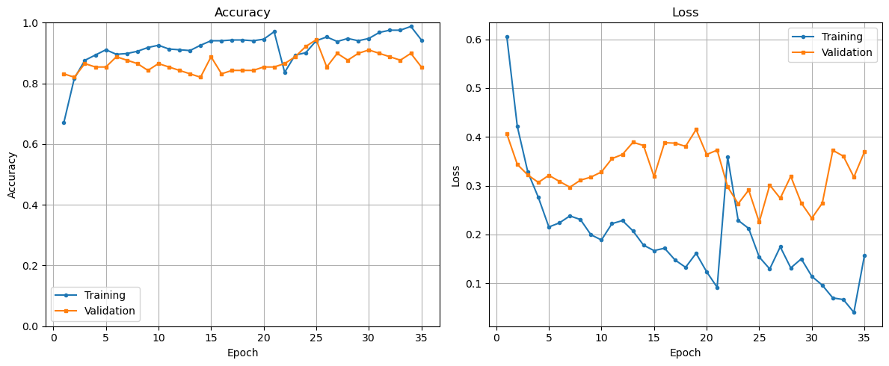
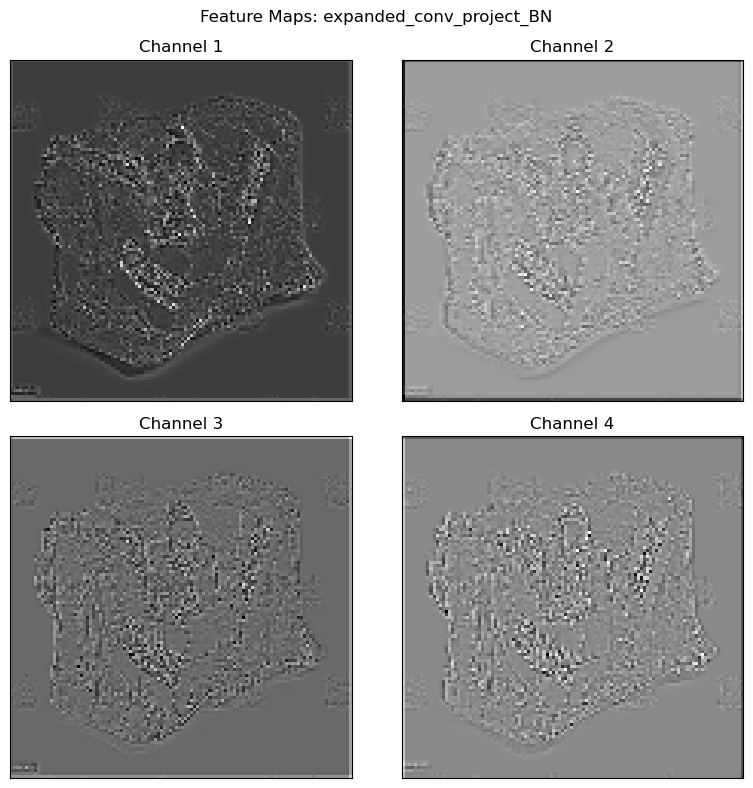
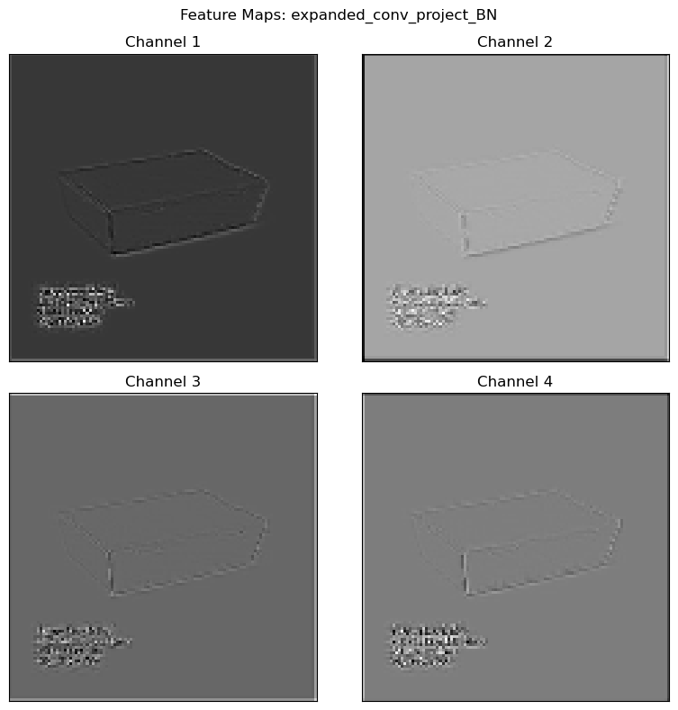

# Parcel Damage Detection with Transfer Learning (MobileNetV2)

An automated visual inspection system that classifies shipping parcels as **intact** or **damaged** from a single camera image. It is built for quality control in e-commerce logistics hubs, where manual inspection is slow, subjective and error-prone. The model is lightweight (about 2.4M parameters), so it can run on edge devices next to a conveyor belt.

> Group mini-project (Group 6) in *Machine Vision*, M.Eng. Applied AI for Digital Production Management, Technische Hochschule Deggendorf (Campus Cham), winter semester 2025/26.


---

## Problem

Damaged parcels that slip through a warehouse cause customer complaints, returns and expensive reverse logistics. Manual checks don't scale with growing parcel volumes and depend on how tired the inspector is. The goal was an "always-on eye" that flags damaged boxes automatically, with **over 90% accuracy** on unseen images and a model small enough for edge hardware.

## Data

| Class | Images |
|---|---|
| Intact | 342 |
| Damaged (crushed, torn, wet, dented) | 286 |
| **Total** | **628** |

Each class is split separately: 70% training, 15% validation and 15% test, which keeps the class balance in every set. A few unreadable files are skipped by the data loader (403 / 89 / 90 images used). See [`data/README.md`](data/README.md).

## Approach

**1. Data augmentation (training set only):** rotation ±30°, width and height shift 20%, shear, zoom 20% and horizontal flips. This simulates different camera angles and distances and limits overfitting on a small dataset.

**2. Model: MobileNetV2 with transfer learning**

```
Input 224×224×3
 └─ MobileNetV2 base (ImageNet weights, no top)
     └─ GlobalAveragePooling2D → Dropout(0.3) → Dense(128, ReLU) → Dropout(0.3) → Dense(2, Softmax)
```

MobileNetV2 was chosen over VGG16 or ResNet50 because its depthwise separable convolutions keep the model small and fast. That gives 2,422,210 parameters in total, of which 164,226 are trained in phase 1.

**3. Two-phase training**

| Phase | What is trained | Optimizer |
|---|---|---|
| 1: Head training | New classification head only (base frozen) | Adam, learning rate 1e-3 |
| 2: Fine-tuning | Top 30 MobileNetV2 layers unfrozen | Adam, learning rate 1e-4 |

The callbacks are ModelCheckpoint (best validation accuracy), EarlyStopping (restores the best weights) and ReduceLROnPlateau.

**4. Confidence threshold:** predictions below 75% confidence are flagged for **manual review**, giving a human-in-the-loop workflow for borderline cases such as light scuffs.

## Results

| Metric | Value |
|---|---|
| Test accuracy (run in the course report) | **91.1%** |
| Test accuracy (latest run saved in this notebook) | **87.8%** (79 of 90 test images) |
| Validation accuracy, best checkpoint (latest run) | 94.4% |
| Model size | 2.4M parameters |

The test set is small (90 images), so a few images move the accuracy by several points. A larger test set, or cross-validation, would give a more stable estimate.



### What the network looks at

Feature maps from an early MobileNetV2 layer show the edges, creases and shadows that separate a dented box from an intact one:

| Damaged parcel | Intact parcel |
|---|---|
|  |  |

## Limitations and next steps

- **Small dataset:** about 600 images is little for deep learning. More images, plus a test set from a different camera or site, would test generalisation better.
- **Lighting:** the model relies on the shadows created by dents, so poorly lit areas reduce reliability.
- **Subjective labels:** "minor scuff" vs "damaged" is a grey area, which is why low-confidence predictions are flagged.
- **Next step:** convert to TensorFlow Lite and test inference speed on edge hardware such as a Raspberry Pi or Jetson Nano.

## Project structure

```
parcel-damage-detection-mobilenetv2/
├── notebooks/parcel_damage_detection_mobilenetv2.ipynb   # Full pipeline with outputs
├── figures/                                              # Learning curves, filters, feature maps
├── docs/Parcel_Damage_Detection_Presentation.pdf         # Project presentation
├── data/README.md                                        # Expected dataset layout
└── requirements.txt
```

## How to run

```bash
git clone https://github.com/sathwikpannati/parcel-damage-detection-mobilenetv2.git
cd parcel-damage-detection-mobilenetv2
pip install -r requirements.txt
# place the image folders as described in data/README.md (next to the notebook), then:
jupyter notebook notebooks/parcel_damage_detection_mobilenetv2.ipynb
```

## Team

| Member | Contribution |
|---|---|
| **Sathwik Pannati** | MobileNetV2 architecture implementation, Python coding |
| Apoorva Challa | Data collection, data splitting strategy, documentation |
| Alp Basaran | Experimental testing, validation analysis, confidence-threshold logic |
| Mani Kiran Kalikivayi | Two-phase fine-tuning, hyperparameter optimisation |

## References

1. Sandler, M. et al. (2018). MobileNetV2: Inverted Residuals and Linear Bottlenecks. *CVPR*, 4510–4520.
2. Pan, S. J. & Yang, Q. (2010). A Survey on Transfer Learning. *IEEE TKDE*, 22(10), 1345–1359.
3. Kingma, D. P. & Ba, J. (2015). Adam: A Method for Stochastic Optimization. *ICLR*.

---

**Sathwik Pannati** · M.Eng. Applied AI for Digital Production Management, Technische Hochschule Deggendorf
[LinkedIn](https://www.linkedin.com/in/sathwik-pannati-803a03254/) · [GitHub](https://github.com/sathwikpannati)
